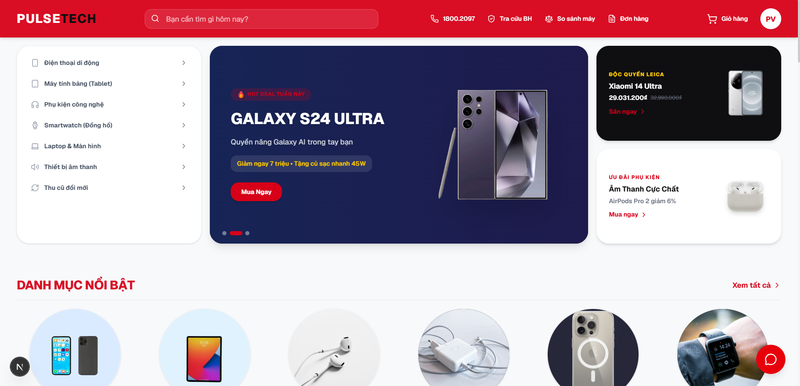
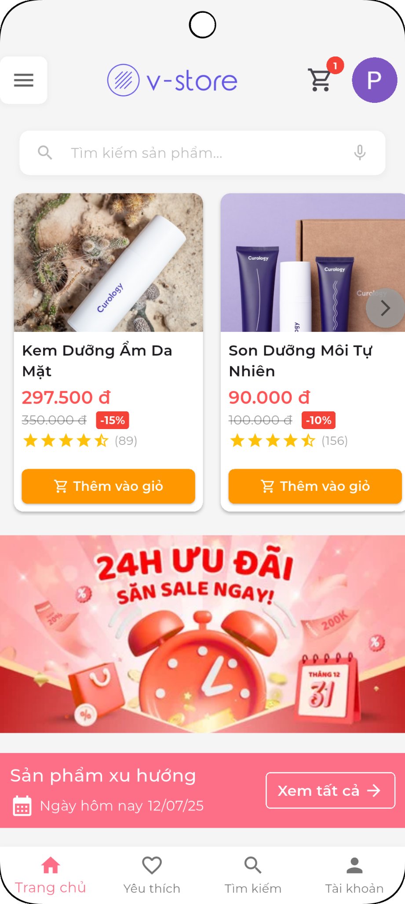
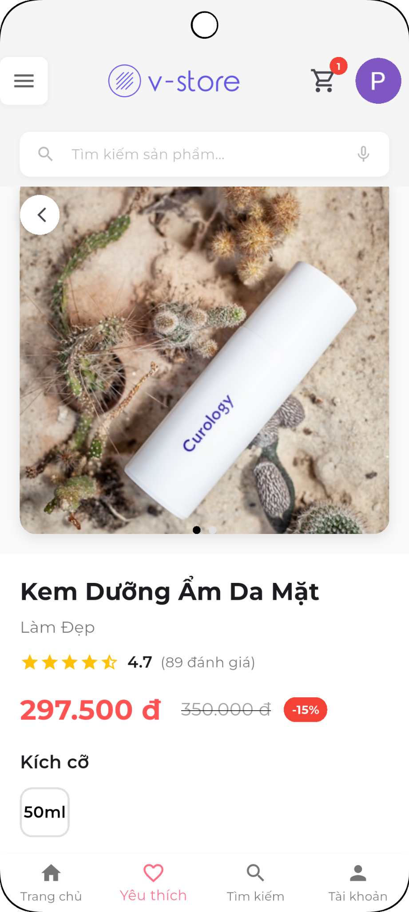
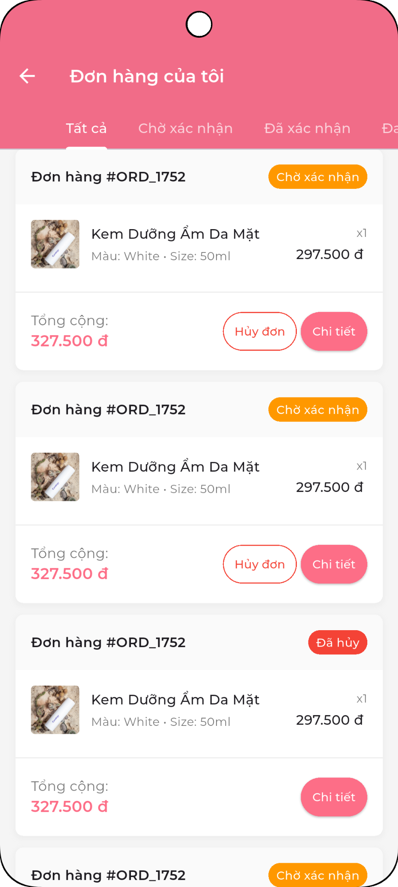

# Hi there, I'm Vu 👋

Software Engineering graduate from Industrial University of Ho Chi Minh City, Vietnam.  
I build backend services with Java and Spring Boot, and mobile experiences with Flutter.

## 👨‍💻 A little about me

- 📍 Based in Ho Chi Minh City, Vietnam
- ⚙️ Professional experience with product management, retail pricing, inventory, and cloud subscription services
- 📱 Hands-on Flutter experience through an internship and personal e-commerce projects
- 🌱 Currently strengthening my Android development skills with Kotlin
- 🤝 Interested in opportunities where I can contribute to real products and grow with an engineering team

## 🧰 My development toolkit

### ⚙️ Backend & data

Java · Spring Boot · REST APIs · GraphQL · Spring Cloud Gateway

### 📱 Mobile development

Flutter · Dart · Firebase · Provider · MVVM · Kotlin (learning)

### 🎨 Web & development tools

## 🚀 Project highlights

### 🖥️ [PulseTech](https://github.com/VuIceTea/PulseTech)
> Technology e-commerce · Personal project

A technology e-commerce storefront that brings product discovery, shopping, and order management into one responsive experience. Customers can search and filter products, manage wishlists and addresses, complete checkout with VNPay, and track their orders.

**Stack:** Next.js · React · TypeScript · Tailwind CSS  
**Backend integration:** API Gateway connecting the storefront to backend services

---

### 🛍️ [V-Store](https://github.com/VuIceTea/v-store)
> Mobile shopping experience · Personal project

&nbsp;

&nbsp;

A Flutter e-commerce application covering the shopping journey from onboarding and product discovery to checkout and order tracking. Built with Firebase for authentication, storage, and real-time data, with Provider state management and an MVVM-based architecture.

**Highlights:** Product search and filters · Persistent cart · Wishlist · VNPay integration · Order history · Dark/light themes  
**Stack:** Flutter · Dart · Firebase · Provider · MVVM

## 💼 Where I've contributed

### 🏢 Long Van — Backend Developer
**March 2026 – Present**

- Develop Java and Spring Boot services for multi-tenant product management and cloud subscriptions using GraphQL, REST APIs, MongoDB, and Redis
- Implement retail and rental pricing, product publishing workflows, tenant-scoped access, and inventory aggregation
- Support subscription provisioning and lifecycle management from customer orders to active services

### 📱 Thien Tu Telecom — Software Development Intern
**August 2025 – November 2025**

- Contributed to **ThoTop**, a Flutter application connecting customers with air-conditioning and refrigeration technicians
- Developed mobile features, integrated REST APIs, and worked with the team on debugging, testing, and Git-based delivery

## 📬 Let's connect

**Have a project or an opportunity in mind? Let's talk.**

📧 **phivu20030411@gmail.com** · 📍 **Ho Chi Minh City, Vietnam**

